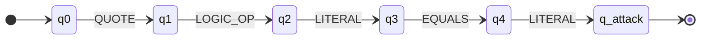

# Automaton-WAF 🛡️

**Deterministik Sonlu Otomat (DFA) ve biçimsel dil teorisi ile geliştirilmiş, hafif bir ters vekil (reverse proxy) Web Uygulama Güvenlik Duvarı.**

Automaton-WAF, gelen HTTP trafiğini geri izleme (backtracking) yapabilen düzenli ifade (RegEx) kuralları yerine
bir durum makinesiyle analiz eder. Her girdi tek geçişte, doğrusal zamanda (**O(n)**) işlenir. Bu sayede
ReDoS (düzenli ifade kaynaklı hizmet reddi) gibi sorunlara karşı yapısal olarak dayanıklıdır. Şu anki sürüm
**SQL Injection (SQLi)** saldırılarını tespit edip engellemeye odaklanır.

## 📌 Özellikler

- **DFA tabanlı durum makinesi:** Kurallar JSON formatında tanımlanır. Girdi sembolleri üzerinde durum
  geçişleri yapılarak kabul durumuna (`q_attack`) ulaşılıp ulaşılmadığı denetlenir.
- **Sözcüksel ayrıştırıcı (lexical tokenizer):** Ham URL parametrelerini ve POST istek gövdelerini anlamsal
  belirteçlere (`QUOTE`, `LOGIC_OP`, `EQUALS`, `LITERAL`) dönüştürür.
- **Asenkron ters vekil:** Temiz istekleri `httpx` üzerinden arkadaki web sunucusuna iletir, tespit edilen
  saldırıları doğrudan `403 Forbidden` ile engeller.
- **Alt dizi taraması:** URL veya parametre içinde herhangi bir konuma gizlenmiş zararlı dizilimleri yakalar.

## 📐 Mimari

```
İstemci ──► Automaton-WAF (:8000) ──► Arka uç sunucu (:5000)
                  │
                  ├─ Tokenizer: ham istek → belirteç dizisi
                  ├─ DFA: belirteçler üzerinde durum geçişleri
                  └─ q_attack'a ulaşıldıysa → 403 Forbidden
```

### DFA durum geçişleri

SQL Injection tespitinde kullanılan durum zinciri:



| Durum | Anlamı |
|---|---|
| `q0` | Başlangıç durumu (temiz akış) |
| `q1` | Tırnak (`'` veya `"`) açıldı |
| `q2` | Mantıksal operatör (`OR`, `AND`, `XOR`) geldi |
| `q3` | Değer (`1`, `admin` vb.) geldi |
| `q4` | Eşittir (`=`) operatörü geldi |
| `q_attack` | **Kabul durumu:** saldırı algılandı, istek engellenir |

## 🚀 Kurulum ve çalıştırma

```bash
git clone https://github.com/keremd0/automaton-waf.git
cd automaton-waf
python3 -m venv venv
source venv/bin/activate
pip install -r requirements.txt
```

WAF'ı başlat. Varsayılan olarak `http://127.0.0.1:5000` adresindeki sunucuyu korur:

```bash
uvicorn main:app --port 8000
```

## 🧪 Test ve doğrulama

**Güvenli istek (izin verilir):**

```bash
curl -i "http://127.0.0.1:8000/?id=123"
```

Yanıt: `HTTP/1.1 200 OK`. İstek arkadaki sunucuya iletilir.

**SQL Injection saldırısı (engellenir):**

```bash
curl -i "http://127.0.0.1:8000/?id=%27%20OR%201=1"
```

Yanıt: `HTTP/1.1 403 Forbidden`, gövde: `[!] WAF: Saldiri tespit edildi, gecemezsin!`

## ⚠️ Sınırlamalar

Bu proje, otomata teorisinin güvenlik alanındaki uygulamasını gösteren bir prototiptir; üretim ortamında
tek başına bir WAF olarak kullanılmamalıdır. Bilinen sınırlamalar:

- **Tek bir saldırı kalıbı:** Mevcut durum zinciri `' OR 1=1` tipi saldırıları yakalar. Şu tür varyasyonlar
  henüz kapsanmıyor:
  - Tırnaksız sayısal enjeksiyon: `?id=1 OR 1=1`
  - `UNION SELECT` ve yorum tabanlı saldırılar: `' --`, `'/**/OR/**/1=1`
  - Eşittir kullanmayan koşullar: `' OR 2>1`, `' OR TRUE`
  - Çift URL kodlama: `%2527`
- **Yanlış pozitif riski:** Alt dizi taraması, masum metinlerde de (örneğin `Don't worry or panic, x=1`)
  saldırı dizisini bulabilir. Gerçek kullanımda bağlama duyarlı kurallar gerekir.
- **Kapsam:** Şu an yalnızca SQL Injection hedefleniyor; XSS, komut enjeksiyonu gibi saldırılar
  tespit edilmiyor.

## 🗺️ Yol haritası

- [ ] Birden fazla DFA'yı tek otomatta birleştirme (UNION, yorum ve sayısal enjeksiyon kalıpları)
- [ ] URL kod çözümünü normalize etme (çift kodlama, büyük/küçük harf, yorum temizleme)
- [ ] XSS ve komut enjeksiyonu için ek otomatlar
- [ ] Yanlış pozitif oranını ölçmek için masum ve zararlı veri setleriyle test
- [ ] RegEx tabanlı bir WAF ile performans karşılaştırması (benchmark)

## ⚖️ Sorumlu kullanım

Bu proje eğitim ve araştırma amaçlıdır. Testleri yalnızca sahibi olduğun veya test etmek için yetki aldığın
sistemlerde yap.
